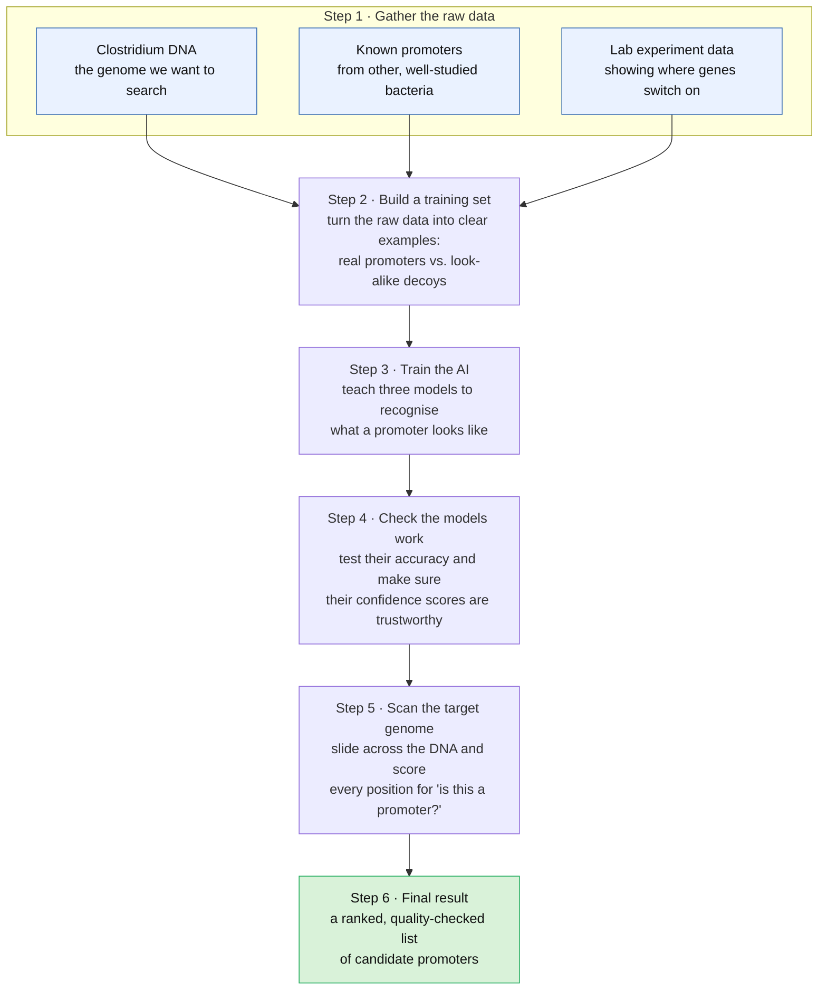

# Genome Mining Project for Clostridium Butyricum DSM 10702 Strain

This project uses 2 fine-tuned genomic language models ([ProkBERT-mini](https://github.com/nbrg-ppcu/prokbert) and [Nucleotide Transformer](https://github.com/instadeepai/nucleotide-transformer)), in addition to a custom trained CNN for genomic minimg of Clostridium Butyricum to discover new and novel parts (only promoter for now) as well as their strengths.

## How the Project Works

### Why three models?
Three different AI models each score the DNA independently, and we combine their votes — if they agree, we're far more confident a spot is a real promoter. We also run experimental and statistical checks so the final list is reliable and not just a guess.

