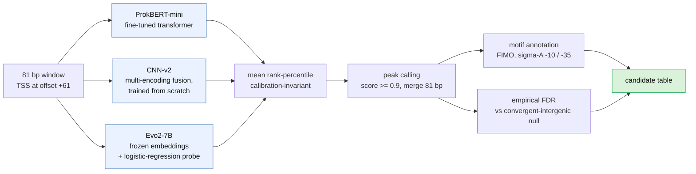
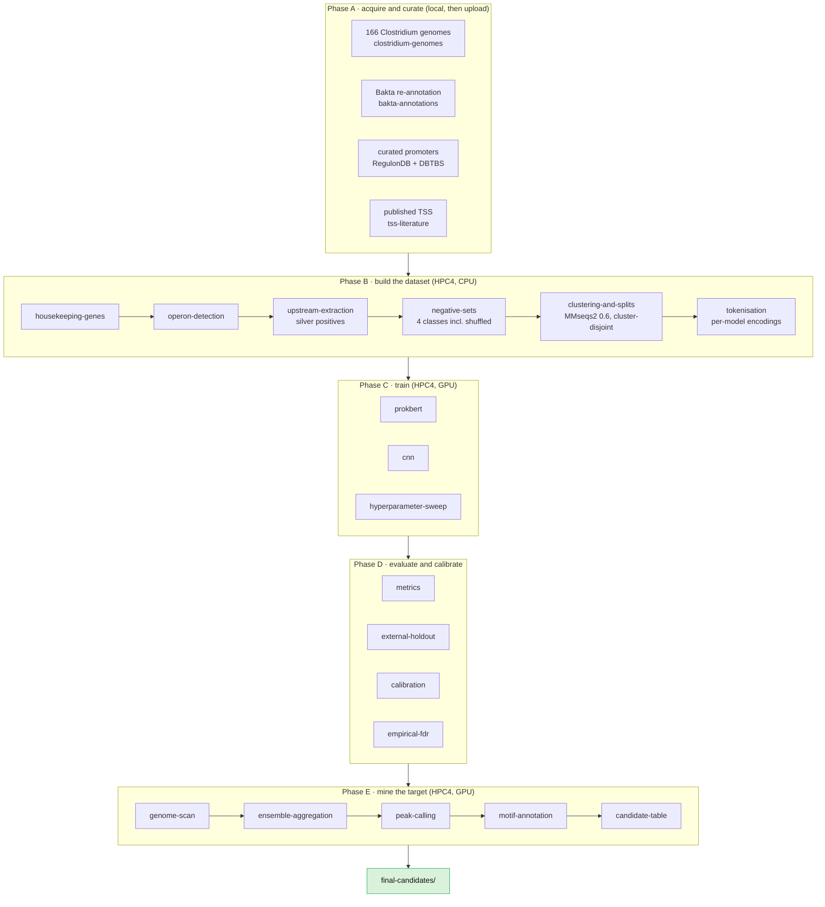

# Promoter Mining in *Clostridium butyricum* DSM 10702

**HKUST iGEM 2026 — Dry Lab.** We mine the genome of *Clostridium butyricum* DSM 10702 for
**constitutive promoters** using an ensemble of three DNA models, then filter the hits with
statistical and motif-level checks.

A promoter is a short stretch of DNA that switches a gene on. Finding them by hand is slow, so we
train models to score every position in the genome and keep only the positions all three models
agree on.

**Delivered:** 929 confident candidates on the reference assembly, every one of them statistically
significant against an empirical null. 180 carry a placed −10 box, and 45 are canonical with both a
−10 and a −35. The 45 are the wet-lab shortlist.

> **The hard part.** *Clostridium* genomes are AT-rich, roughly 28–32% GC, and promoter motifs are
> *also* AT-rich. A naive model learns "AT-rich means promoter" and floods you with false positives.
> Most of the design below exists to fight that. See [`WORKFLOW_RATIONALE.md`](WORKFLOW_RATIONALE.md).

---

## How the project works


### Why three models?

Each model scores the DNA independently. We convert each model's scores to **rank percentiles** and
average them, so a position only ranks highly if all three rank it highly. Rank percentile is
scale-invariant, which means the ensemble works on raw scores and needs no calibration first.



We evaluated three more models and dropped them. Nucleotide Transformer v2 with LoRA and NTv3 both
scored well on the balanced test set but collapsed at genome scale, and CNN-v1 was a weaker,
correlated cousin of CNN-v2 that actively diluted the ensemble average. Balanced accuracy and
genome-scale precision are not the same metric, and this project is a sharp example of the gap.

---

## The models are on Hugging Face

Published under the [`CloBiT`](https://huggingface.co/CloBiT) org.

| Model | What it is | License |
|---|---|---|
| `CloBiT/prokbert-mini-clostridium-promoter` | fine-tune of `neuralbioinfo/prokbert-mini` | CC-BY-NC-4.0 |
| `CloBiT/cnn-fusion-clostridium-promoter` | multi-encoding fusion CNN, our own weights | CC-BY-4.0 |
| `CloBiT/evo2-logreg-clostridium-promoter-probe` | logreg probe on frozen Evo2-7B embeddings | CC-BY-4.0 |

> **Status:** the repos are created **private**. If `from_pretrained` returns a 401, they have not
> been flipped public yet — ask the team, or authenticate with an account that has access.
>
> **Licensing:** the ProkBERT fine-tune inherits CC-BY-NC from its base model, so it is
> non-commercial. The CNN and the Evo2 probe are ours and permissive. They are published as three
> separate repos precisely so the non-commercial term does not spread to the other two.
>
> The Evo2 repo contains the **probe only**. Evo2's own weights are not re-uploaded; you get those
> from the Arc Institute release.

### Score a sequence with the ProkBERT model

```python
import torch
from transformers import AutoTokenizer, AutoModelForSequenceClassification

REPO = "CloBiT/prokbert-mini-clostridium-promoter"
# The tokenizer is unchanged from the base model, so load it from there: this repo ships the
# fine-tuned weights and custom architecture, not a copy of the base tokenizer.
tok = AutoTokenizer.from_pretrained("neuralbioinfo/prokbert-mini", trust_remote_code=True)
model = AutoModelForSequenceClassification.from_pretrained(REPO, trust_remote_code=True).eval()

seq = "A" * 81                      # your 81 bp window, TSS at offset 60
inputs = tok(seq, return_tensors="pt")
with torch.no_grad():
    p = torch.softmax(model(**inputs).logits, dim=1)[0, 1].item()
print(f"P(promoter) = {p:.3f}")
```

Publishing tooling and the full model cards live in
[`huggingface_release/`](huggingface_release/). To re-publish, edit `HF_OWNER` and the two checkpoint
paths at the top of `upload_to_hf.py`, then run it with `--dry-run` first.

### Score sequences with a local checkpoint instead

`score_promoters.py` at the repo root is the single hand-off entry point. It takes a FASTA and one
model name, and writes a CSV of probabilities.

```bash
source /project/igem2026/cb-promoter-mining/env.sh
conda activate /project/igem2026/envs/promoter-mining-hpc4
python score_promoters.py --model prokbert --fasta seqs.fa --out scores.csv
python score_promoters.py --model cnn_v2   --fasta seqs.fa --out scores.csv
```

---

## Reproducing the pipeline



### What you need first

| Requirement | Detail |
|---|---|
| Cluster | HKUST SuperPOD, `ssh <user>@superpod.ust.hk`, VPN from off campus |
| Slurm account | `igem2026` on every job; use partition `preempt` |
| GPU | NVIDIA H800, CUDA 12.8. Never run a bare `pip install torch`, it pulls a CUDA-13 build that silently falls back to CPU |
| Main env | `/project/igem2026/envs/promoter-mining-hpc4`, transformers 5.3.0 |
| NT env | `/project/igem2026/envs/nt-tf4x`, transformers 4.57. **Only** the Nucleotide Transformer needs this |
| MEME env | `/project/igem2026/envs/meme` for FIMO. It has no pandas, so run FIMO there and parse elsewhere |

New to the cluster, start with [`infrastructure/HPC4_GUIDE.md`](infrastructure/HPC4_GUIDE.md).
Building the environment is covered in
[`infrastructure/conda-environments/DEPLOY.md`](infrastructure/conda-environments/DEPLOY.md).

### Step 0 — clone and check the wiring

Every pipeline step is wired into a Snakemake DAG. Dry-run it before you run anything for real; this
is the fastest way to confirm your paths and config are sane.

```bash
git clone <this repo> && cd cb-promoter-mining
cd infrastructure/T3/snakemake_scaffold
snakemake -n                       # builds the DAG, runs nothing
```

Phase A has its own two workflows, `local_prep.smk` and `tss_prep.smk`.

> **Path convention:** the data steps write into `results/` *relative to the scaffold directory*.
> Run them from `infrastructure/T3/snakemake_scaffold/` and call scripts through `../../../`, which
> is why the commands below look the way they do.

### Step 1 — Phase A, acquire the data

Phase A runs locally and its outputs are uploaded to the cluster as pre-staged `inputs/` files. The
genomes, annotations and curated promoter tables are already committed, so in most cases you can
skip straight to Phase B.

```bash
cd infrastructure/T3/snakemake_scaffold
snakemake -s local_prep.smk --cores 4
```

### Step 2 — Phase B, build the dataset

```bash
cd /project/igem2026/cb-promoter-mining/infrastructure/T3/snakemake_scaffold
conda activate /project/igem2026/envs/promoter-mining-hpc4

# housekeeping genes -> operons -> upstream windows -> negatives
snakemake --workflow-profile profiles/slurm

# cluster-disjoint splits (the anti-leakage guard)
python ../../../dataset-construction/clustering-and-splits/cdhit_splits.py \
  --positives inputs/reference_promoters.parquet inputs/published_tss_promoters.parquet \
              inputs/literature_promoters_train.parquet results/T13/upstream_regions.tsv \
  --negatives results/T14/negative_set.tsv \
  --identity 0.6 --silver-weight 0.3 --seed 42 --out results/T15/

# per-model encodings
python ../../../dataset-construction/tokenisation/tokenise.py results/T15/ results/T16/
```

Two details that matter more than they look:

- **Cluster-disjoint splits.** Sequences sharing 60% identity land in the same cluster, and whole
  clusters stay on one side of the split. Without this, near-duplicates leak across train and test
  and every score is inflated. CD-HIT cannot cluster DNA below about 0.8, so the script
  automatically routes anything under that to MMseqs2.
- **Silver weighting.** Housekeeping-gene upstream windows are *inferred* positives, not measured
  ones, so they carry weight 0.3 against 1.0 for verified promoters. At full weight the AT-rich
  inferred windows would teach exactly the "AT-rich means promoter" shortcut we are trying to avoid.

### Step 3 — Phase C, train

```bash
cd /project/igem2026/cb-promoter-mining/infrastructure/T3/snakemake_scaffold
python -c "import torch; assert torch.cuda.is_available(), 'NO GPU'"

python ../../../model-training/prokbert/train_prokbert.py \
  --data-dir results/T16/prokbert --output-dir results/T18

python ../../../model-training/cnn/train_cnn_v2.py \
  --data-dir results/T16/cnn --output-dir results/T20

# Nucleotide Transformer ONLY: different env
conda activate /project/igem2026/envs/nt-tf4x
python ../../../model-training/nucleotide-transformer/train_nt_lora.py \
  --data-dir results/T16/nt --output-dir results/T19 --no-grad-checkpoint
```

Write `--output-dir` to the shared `/project` clone, not your home directory, so the mining step and
the rest of the team can read the checkpoints.

### Step 4 — Phase D, evaluate

```bash
python ../../../evaluation-and-calibration/metrics/predict_and_score.py      # balanced metrics
python ../../../evaluation-and-calibration/external-holdout/evaluate_external_holdout.py
```

Judge models on **genome-scale precision**, not just balanced AUPRC. The full regime-by-regime
comparison is in [`evaluation-and-calibration/REGEN_EVAL_0.6.md`](evaluation-and-calibration/REGEN_EVAL_0.6.md).

### Step 5 — Phase E, mine the target

This is the part that produced the delivered candidate list. It runs inference only; the target
genome is never trained on.

```bash
# 1) stage the complete genome + candidate regions  (login node)
bash mining-and-motif-annotation/genome-scan/prep_g131795.sh
OUT=infrastructure/T3/snakemake_scaffold/results/regimeC/mine3_g131795

# 2) 3-model mine  (GPU, target-mine mode: TRUTH="" disables benchmarking)
TAG=g131795 TRUTH="" MODELS="prokbert cnn_v2 evo2" STEP=10 \
  FASTA=$PWD/$OUT/g131795.fna REGIONS=$PWD/$OUT/g131795_candidate_regions.bed \
  sbatch mining-and-motif-annotation/genome-scan/mine_3model.sbatch

# 3) call peaks
python mining-and-motif-annotation/peak-calling/call_peaks.py \
  --track $OUT/g131795_shortlist_3m_restricted.csv \
  --min-score 0.9 --merge 81 --out $OUT/g131795_peaks.csv

# 4) pull sequences, then annotate -10 / -35 with FIMO
python mining-and-motif-annotation/motif-annotation/extract_call_sequences.py \
  --calls $OUT/g131795_peaks.csv --genome $OUT/g131795.fna \
  --min-windows 5 --top-n 500 \
  --out-fasta $OUT/g131795_call_seqs.fasta \
  --out-top $OUT/g131795_call_seqs_top.fasta \
  --out-calls $OUT/g131795_calls_with_id.tsv

conda activate /project/igem2026/envs/meme
bash mining-and-motif-annotation/motif-annotation/annotate_motifs.sh \
  $OUT/g131795_call_seqs_top.fasta $OUT/g131795_call_seqs.fasta $OUT/t31_g131795
conda activate /project/igem2026/envs/promoter-mining-hpc4

# 5) build the final candidate table
python mining-and-motif-annotation/candidate-table/build_candidate_table.py \
  --calls $OUT/g131795_calls_with_id.tsv \
  --fimo $OUT/t31_g131795/fimo/fimo.tsv \
  --out $OUT/g131795_candidates.tsv --jsonl $OUT/g131795_candidates.jsonl
```

### Step 6 — rank for the wet lab

```bash
python mining-and-motif-annotation/prioritize_candidates.py \
  $OUT/g131795_candidates_fdr.tsv --tag g131795 --outdir final-candidates/
```

Full runbook with every flag and the recovery paths:
[`mining-and-motif-annotation/REMINE_g131795_CLAUDE.md`](mining-and-motif-annotation/REMINE_g131795_CLAUDE.md).

---

## Repo map

```
cb-promoter-mining/
├── score_promoters.py              # score a FASTA with one model
├── data-acquisition-and-curation/  # genomes, annotations, curated + published promoters
├── dataset-construction/           # housekeeping -> operons -> windows -> negatives -> splits
├── model-training/                 # prokbert, cnn, nucleotide-transformer, Evo2
├── evaluation-and-calibration/     # metrics, holdouts, calibration, empirical FDR
├── mining-and-motif-annotation/    # genome scan -> ensemble -> peaks -> motifs -> table
├── final-candidates/               # the delivered candidate tables and wet-lab shortlists
├── prototypes/                     # early learning exercises, some reused downstream
├── huggingface_release/            # model cards + upload script
└── infrastructure/                 # Snakemake pipeline, conda environments, cluster guide
```

Directories are named for what they do. Each one's task number from the project brief is in the
comment beside it in [`CLAUDE.md`](CLAUDE.md) §3, so the T-numbers used across the docs still map.

---

## Reading the results honestly

- **This is an enriched candidate list, not a precise map.** At genome scale the base rate of real
  promoters is tiny, which caps achievable precision no matter how good the model is.
- **The FDR step validates, it does not rank.** All 929 candidates clear q ≤ 0.05, and the top tier
  sits at the null's resolution floor. Rank by `peak_score`, not by q-value.
- **"Canonical" is a motif convenience, not a biological verdict.** De-novo motif discovery is run
  per-mine and is not perfectly stable between runs, which is why the canonical count moved between
  assemblies. The robust deliverable is the 929 plus the score ranking.
- **A missing −10 is not a missing promoter.** On an AT-rich genome the −10 box is the conserved
  signal and the −35 often is not, so "−10 only" dominating is expected.

## Data and attribution

Training positives come from RegulonDB (*E. coli*), DBTBS (*B. subtilis*), and published TSS
catalogues for *B. licheniformis*, *Ruminiclostridium cellulolyticum*, *C. acetobutylicum* and
*C. beijerinckii*. *C. ljungdahlii* is deliberately held out as the validation genome. The target,
*C. butyricum* DSM 10702, is excluded from every training set.

Licensed under the terms in [`LICENSE`](LICENSE). Project context, decisions and the full task table
are in [`CLAUDE.md`](CLAUDE.md).
