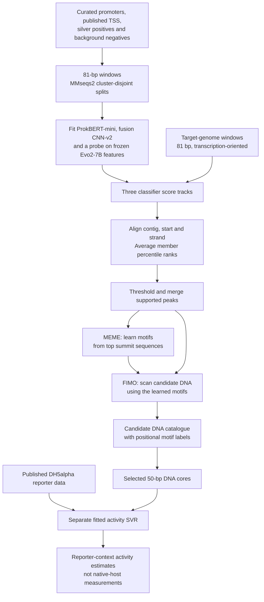

# Promoter mining in *Clostridium butyricum*

**HKUST iGEM 2026.** We rank promoter-like DNA in *C. butyricum* DSM 10702 using fine-tuned ProkBERT-mini, a fusion CNN and a logistic probe on frozen Evo2-7B embeddings. Motif annotations then help prioritise sequences for testing. A separate DH5α-trained SVR estimates reporter-core activity; it is not part of the mining ensemble.

## Workflow at a glance



The independent SVR receives candidate **DNA**, not ensemble scores. Neither the
ranking nor the motif labels establish promoter activity.

## Results and downloads

| Output | Result | Interpretation |
|---|---|---|
| Complete-reference mine, **GCF_014131795.1** | **929 regions; 180 with placed −10; 45 with both placed motif classes** | Nested computational shortlist, not 929 validated promoters |
| Paired genomic benchmark, precision proxy at recall 0.5 | **61.6%** (*C. ljungdahlii*); **76.6%** (*C. autoethanogenum*) | Restricted published-TSS recovery, not measured biological purity |
| Deployed held-out test AP | ProkBERT **0.82494**; CNN **0.72558**; Evo2 probe **0.70258** | Classification of putative/curated labels, not expression strength |
| First-ten DH5α core predictions | `cand_00098` leads at **32.8751 AU**, **474.57%** of the primary predicted `pptb_fU` core | A model/reference-framing comparison, not measured improvement |
| Oxidative-stress-associated search | **24 peaks**; no motif test passes adjusted q≤0.05 | Separate exploratory candidates; activity and stress protection unvalidated |

**[Download results, DNA and provenance](results/README.md)**: ranked catalogue, 45 both-hit sequences, named DL1–DL10 FASTA/TSV, reporter/reference DNA, gene context, strength predictions, benchmark CSV, oxidative-stress candidates and 166-assembly training manifest.

Read **[Results](docs/RESULTS.md)** for protocols and limitations and **[DH5α strength predictions](docs/ECOLI_STRENGTH_PREDICTIONS.md)** for all ten numerical estimates and framing sensitivity. **DL10 is `cand_00101` / `P_prfB`; `pptb_fU` is an independent reference**, despite its older notebook alias.

The team reports plasmid ordering, transformation and GFP testing in *E. coli*. Candidate-linked quantitative assay data and reporter strain were not supplied here; native Cb validation was not reached. The separate [codon optimiser](https://github.com/HKUST-iGEM-2026/codon-optimiser) and [oxidative-stress workflow](pipeline/mining/oxidative-stress/README.md) were prepared for future constructs, not used in experimental constructs. These computational results do not establish improved expression, constitutivity or protection.

## Use the models

All four [CloBiT model packages](docs/MODELS.md#public-hugging-face-repositories) are **public and ungated**: project-package downloads need no account or token. Uploading requires write authorisation. They are component packages, not a hosted prediction service or a packaged three-model ensemble. Review remote code before execution, trust only verified pickle sources, and preserve upstream/data licences.

The fitted DH5α SVR is also included locally. From the repository root, score the real retained first-ten inputs without refitting:

```bash
uv run --no-project --with numpy==2.5.3 python \
  pipeline/mining/strength-prediction/predict_dh5alpha_strength.py \
  --model release/huggingface/dh5alpha-promoter-strength-svr \
  --reference results/candidates/pptb_fU_reference.json \
  --input results/candidates/g131795_tier1_canonical_seq.tsv \
  --top-n 10 --tss-offset 60 --out-prefix /tmp/dh5alpha_first10
```

For one neural classifier, first install [compatible dependencies](docs/SETUP.md) and stage its public checkpoint as described in [Models](docs/MODELS.md):

```bash
source env.sh
conda activate "$ENV_MAIN"
python pipeline/mining/score_promoters.py --model cnn_v2 \
  --fasta results/candidates/g131795_first10_canonical_named.fasta \
  --models-dir "$PROMOTER_RESULTS/T21_xs" --out /tmp/cnn_scores.csv
```

Input is transcription-oriented 81-bp DNA, with nominal TSS offset 60. The CLI's legacy `prob` column is an uncalibrated positive-class score; this command runs neither Evo2 nor the ensemble. The 81-bp frame is a dataset convention, not ProkBERT's context limit.

## Source and reproduction

```text
pipeline/
  acquisition/   genomes, promoter databases and published TSS
  datasets/      labels, controls, splits and encodings
  training/      ProkBERT, fusion CNN and frozen-Evo2 probe
  evaluation/    metrics, benchmarks, calibration and FDR
  mining/        scoring, peaks, motifs, strength and oxidative-stress/ source
workflow/        Snakemake files, profiles, inputs and local run outputs
environments/    conda recipes
release/         Hugging Face cards, fitted artifacts and uploader
results/         public result/download index and retained outputs
docs/            technical guides
analysis/phylogeny/ and archive/prototypes/  historical analyses
```

[Setup](docs/SETUP.md) explains dependencies and staging; [Pipeline](docs/PIPELINE.md) gives stage-specific commands. The legacy default Snakemake target is not an end-to-end reproduction recipe. Source archives use Git LFS; a clone does not contain ignored checkpoints or the large recovered splits/score tracks. Public summary artifacts do not replace those reconstruction prerequisites.

**Important limits:** silver positives are annotation/position-derived putative promoters and negatives are not proven promoter-free. The benchmark genomes supplied silver/negative training windows; only their published TSS truth was withheld. The supervised target genome was excluded, but backbone pretraining exposure is unknown. All deployed members retain **888 wrong-assembly *B. licheniformis* positive windows**; changing documentation does not repair those weights. Reference TSS catalogues are incomplete, and motif/rank support does not measure activity.

Project code/documentation is [MIT](LICENSE). Model artifacts, executable upstream code and source data have distinct terms: see [release licences](release/huggingface/README.md#licences) and the [RegulonDB notice](REGULONDB_LICENSE.md).

## Publish source updates

The SRS documentation correction was already merged in PR #52 (public source commit `7cb586c58529db4f81c0e5e094b2d9d98147cb67`); the live cards inspected in the 2026-11-03 audit matched that publication. It is not a pending publication task.

The source-layout branch is `reorganise`; the GitHub default `main` branch retains the older layout. Historical names such as `T21_xs` identify retained run-output directories, not current source directories. Review the current working tree and index before publishing; do not use a blanket “take theirs” resolution to restore obsolete source directories or undo scientific corrections.

For future documentation-only corrections, review and publish only the intended prose/card-source paths through the normal source pull-request process. Preserve unrelated work and immutable historical receipts, metrics, data and weights. A documentation change does not require retraining or a full artifact release.

Keep the separately maintained local wiki and exports out of the GitHub source payload; their ignored local copies are not part of this documentation update.

Files under `release/huggingface/*/README.md` are **local card sources**, not the live Hub cards. Merging GitHub changes does not sync them. If separately authorised to publish cards, use the [README-only release procedure](release/huggingface/README.md#publish-these-documentation-changes-only), review the exact payload and resulting Hub revision, and keep inspected artifact/code revisions pinned. These instructions do not claim that the current local corrections have been uploaded.
