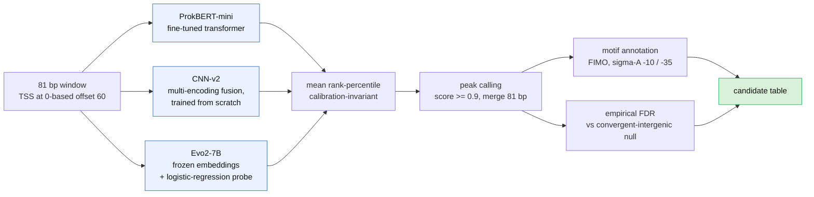
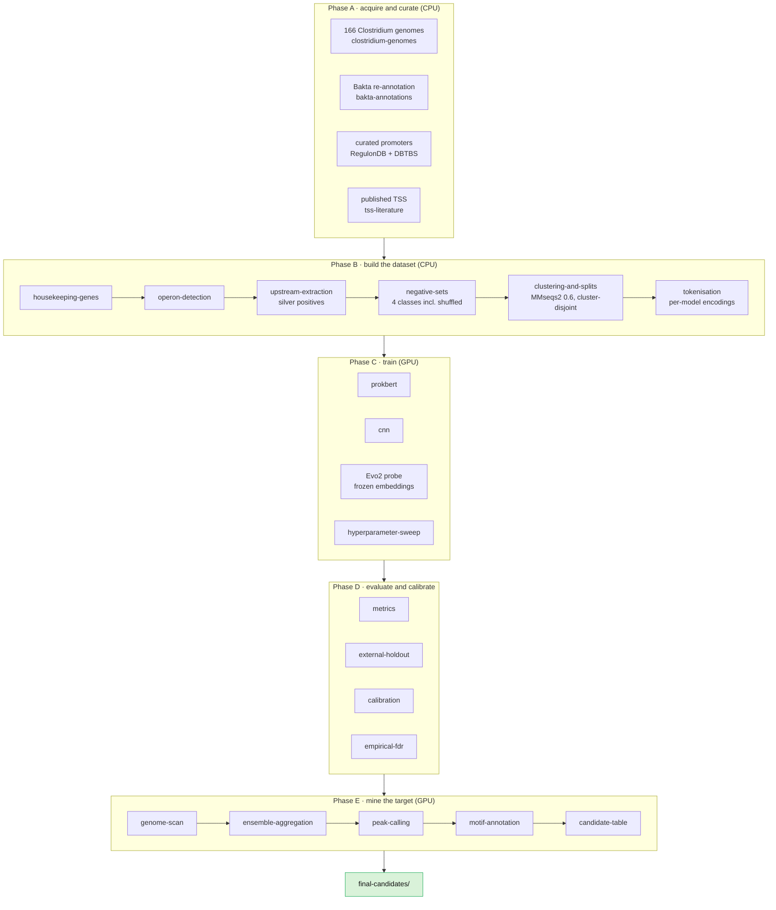

# Promoter Mining in *Clostridium butyricum* DSM 10702

**HKUST iGEM 2026 — Dry Lab.** We mine the genome of *Clostridium butyricum* DSM 10702 for
**constitutive promoters** using an ensemble of three DNA models, then filter the hits with
statistical and motif-level checks. The three trained models are released on Hugging Face at
**[huggingface.co/CloBiT](https://huggingface.co/CloBiT)** (currently private to the organisation).

A promoter is a short stretch of DNA that switches a gene on. Finding them by hand is slow, so we
train models to score every position in the genome and keep only the positions all three models
agree on.

**Delivered:** 929 confident candidates on the complete reference assembly (`GCF_014131795.1`), every
one of them statistically significant against an empirical null. 180 carry a placed −10 box, and 45
are canonical with both a −10 and a −35. The 45 are the wet-lab shortlist. All of the delivered
tables are in [`final-candidates/`](final-candidates/).

> **The hard part.** *Clostridium* genomes are AT-rich, roughly 28–32% GC, and promoter motifs are
> *also* AT-rich. A naive model learns "AT-rich means promoter" and floods you with false positives.
> Most of the design below exists to fight that. The model choices and how each one is validated are
> in [`docs/MODELS.md`](docs/MODELS.md); the plain-language version is in
> [`wiki/design.md`](wiki/design.md).

---

## How the project works


### Why three models?

Each model scores the DNA independently. We convert each model's scores to **rank percentiles** and
average them, so a position only ranks highly if all three rank it highly. Rank percentile is
scale-invariant, which means the ensemble works on raw scores and needs no calibration first.



On two *Clostridium* validation genomes, whose published start sites were never used in training, the
ensemble is the most precise caller at recall 0.5 and within a point of the best single member at
recall 0.1. All numbers come from the same evaluation run: step-10 scans restricted to candidate
regions.

| Validation genome | Ensemble, precision at recall 0.1 / 0.5 | Evo2 probe, the best single member |
|---|---|---|
| *C. ljungdahlii* | 74.4% / 61.6% | 69.4% / 58.4% |
| *C. autoethanogenum* | 87.0% / 76.6% | 87.6% / 72.5% |

Both strains are also among the 166 genomes that supplied inferred positives and negative windows for
training, so the benchmark is not fully independent of training; [`docs/RESULTS.md`](docs/RESULTS.md)
has the details. At recall 0.1 on *C. ljungdahlii*, a finer step-1 CNN-v2 scan reaches 71.6%, still
below the ensemble.

We evaluated three more models and dropped them. Nucleotide Transformer v2 with LoRA and NTv3 both
scored well on the balanced test set but collapsed at genome scale, and CNN-v1 was a weaker,
correlated cousin of CNN-v2 that actively diluted the ensemble average. Balanced accuracy and
genome-scale precision are not the same metric, and this project is a sharp example of the gap.

---

## Use the models from Hugging Face

All three ensemble members live under the [**CloBiT**](https://huggingface.co/CloBiT) organisation.
The repositories are **private**; authenticated access and artifact inventories have been verified.
**Hugging Face artifact recovery is complete (user-reported); the remaining reproducibility
checks are ongoing.** Use the existing authorised login or `HF_TOKEN`; recovery does not establish
a completed historical training/inference rerun.

| Model | What it is | License |
|---|---|---|
| [`CloBiT/prokbert-mini-clostridium-promoter`](https://huggingface.co/CloBiT/prokbert-mini-clostridium-promoter) | fine-tune of `neuralbioinfo/prokbert-mini` | CC-BY-NC-4.0 |
| [`CloBiT/cnn-fusion-clostridium-promoter`](https://huggingface.co/CloBiT/cnn-fusion-clostridium-promoter) | multi-encoding fusion CNN, our own weights | CC-BY-4.0 |
| [`CloBiT/evo2-logreg-clostridium-promoter-probe`](https://huggingface.co/CloBiT/evo2-logreg-clostridium-promoter-probe) | logreg probe on frozen Evo2-7B embeddings | CC-BY-4.0 |

Every model takes an **81 bp** A/C/G/T window with the transcription start site at 0-based offset 60,
and returns `P(promoter)`. Feed a different framing and the scores stop meaning what they meant in
training.

> **Licensing:** the ProkBERT fine-tune inherits CC-BY-NC from its base model, so it is
> non-commercial. The CNN and the Evo2 probe are ours and permissive. They are published as three
> separate repos precisely so the non-commercial term does not spread to the other two.
>
> The Evo2 repo contains the **probe only**. Evo2's own weights are not re-uploaded; you install
> those yourself from the [Arc Institute release](https://github.com/ArcInstitute/evo2) under its own
> Apache-2.0 license.

### Score a sequence with the ProkBERT model

```python
import torch
from transformers import AutoTokenizer, AutoModelForSequenceClassification

REPO = "CloBiT/prokbert-mini-clostridium-promoter"
# The tokenizer is unchanged from the base model, so load it from there: this repo ships the
# fine-tuned weights and custom architecture, not a copy of the base tokenizer.
tok = AutoTokenizer.from_pretrained("neuralbioinfo/prokbert-mini", trust_remote_code=True)
model = AutoModelForSequenceClassification.from_pretrained(REPO, trust_remote_code=True).eval()

seq = "A" * 81                      # your 81 bp window, TSS at offset 60
inputs = tok(seq, return_tensors="pt")
with torch.no_grad():
    p = torch.softmax(model(**inputs).logits, dim=1)[0, 1].item()
print(f"P(promoter) = {p:.3f}")
```

### Score a sequence with the fusion CNN

The repo ships the weights, the architecture config, and `train_cnn_v2.py`, which holds the model
class and the exact feature pipeline used in training.

```python
import json, sys, torch
from huggingface_hub import snapshot_download

path = snapshot_download("CloBiT/cnn-fusion-clostridium-promoter")
sys.path.insert(0, path)
from train_cnn_v2 import build_model_from_config, predict_proba

cfg = json.load(open(f"{path}/config.json"))
model = build_model_from_config(cfg, device="cpu")
model.load_state_dict(torch.load(f"{path}/best_model.pt", map_location="cpu"))
print(predict_proba(model, ["A" * 81], device="cpu"))     # numpy array of P(promoter)
```

### Score a sequence with the Evo2 probe

This one needs a GPU with Evo2 installed, plus scikit-learn 1.9.0 to match the pickled probe.
`apply_probe.py` in the repo runs the whole path from sequences to probabilities.

```bash
hf download CloBiT/evo2-logreg-clostridium-promoter-probe --local-dir evo2_probe
cd evo2_probe
python apply_probe.py --fasta windows.fna --out scores.csv
```

Publishing tooling and the source of each model card live in
[`huggingface_release/`](huggingface_release/). To re-publish, point the two checkpoint paths at the top
of `upload_to_hf.py` at your copies of the weights, then run it with `--dry-run` first.

### Score sequences with a local checkpoint instead

`score_promoters.py` at the repo root is the single hand-off entry point. It takes a FASTA and one
model name, and writes a CSV of probabilities. Checkpoints are too large for git, so it reads ones you
trained yourself: Step 3 below writes them to `results/T21_xs/`. [`docs/MODELS.md`](docs/MODELS.md)
covers the folder layout and loading every checkpoint by hand.

```bash
source env.sh
conda activate "$ENV_MAIN"
python score_promoters.py --model prokbert --fasta seqs.fa --out prokbert_scores.csv --models-dir "$PROMOTER_RESULTS/T21_xs"
python score_promoters.py --model cnn_v2   --fasta seqs.fa --out cnn_v2_scores.csv --models-dir "$PROMOTER_RESULTS/T21_xs"
```

---

## Reproducing the pipeline



### What you need first

| Requirement | Detail |
|---|---|
| Machine | Linux: the main env uses bioconda tools and CUDA 12.8 builds of torch |
| Tools | conda (or mamba), Git LFS, and internet access for the genome downloads in Phases A, B and E |
| GPU | an NVIDIA GPU whose driver supports CUDA 12.8, for training and genome scans only. Never run a bare `pip install torch`, it pulls a newer CUDA build that silently falls back to CPU |
| Main env | `$ENV_MAIN`, transformers 5.3.0. Used by almost every step |
| Evo2 env | `$ENV_EVO2`. The mining job switches into it for the Evo2 member and back out again |
| MEME env | `$ENV_MEME` for FIMO. It has no pandas, so run FIMO there and parse elsewhere |
| NT env | `$ENV_NT`, transformers 4.57. **Only** the benched Nucleotide Transformer needs this |
| Scheduler | optional. The job scripts run under Slurm or with plain `bash` |

`env.sh` names the four environments; building them, running with or without Slurm, and offline
compute nodes are all in [`docs/SETUP.md`](docs/SETUP.md).

### Step 0 — clone, build the environments, check the wiring

Build the environments first ([`docs/SETUP.md`](docs/SETUP.md)). Then dry-run the two workflow
stages you will actually run; a dry run plans the jobs and executes nothing.

```bash
git lfs install
git clone <this repo> && cd cb-promoter-mining
git lfs pull                       # without it the genome and annotation zips are 130-byte pointers
source env.sh                      # sets PROMOTER_REPO and the ENV_* names; do this in every shell
conda activate "$ENV_MAIN"
cd infrastructure/T3/snakemake_scaffold
snakemake -n -s local_prep.smk               # plans Phase A
snakemake -n results/T14/negative_set.tsv    # plans Phase B up to the negatives
```

Don't dry-run the default target (`snakemake -n`) on a fresh clone. It fails with
`MissingInputException`, because it needs Phase A's `inputs/` and also `inputs/tss_sites.gff3`, which
only the optional *C. difficile* track (`tss_prep.smk`) produces.

> **Path convention:** the data steps write into `results/` *relative to the scaffold directory*.
> Run them from `infrastructure/T3/snakemake_scaffold/` and call scripts through `../../../`, which
> is why the commands below look the way they do.

### Step 1 — Phase A, acquire the data

Phase A turns the committed source data into the `inputs/` files that Phase B reads. `inputs/` is
git-ignored, so this step is required on every fresh clone. It takes a few minutes and needs
internet: the in-genus positives are cut from three genomes it downloads with `ncbi-datasets-cli`.

```bash
cd "$PROMOTER_REPO/infrastructure/T3/snakemake_scaffold"
conda activate "$ENV_MAIN"
snakemake -s local_prep.smk --cores 4
```

Check the printed counts: 4,336 curated promoters (3,963 RegulonDB + 373 DBTBS), 93 literature
promoters, and **5,759** published in-genus positives. A lower last number means some genome downloads
failed, and Phase B would silently lose that in-genus signal.

### Step 2 — Phase B, build the dataset

The deployed models train on the **`xs`** (cross-species-augmented) split: everything below plus
published TSS for *B. licheniformis* and *R. cellulolyticum*. These commands build it as `T15_xs`/`T16_xs`.

```bash
cd "$PROMOTER_REPO/infrastructure/T3/snakemake_scaffold"
conda activate "$ENV_MAIN"

# housekeeping genes -> operons -> upstream windows -> negatives (name the target, or it runs the whole DAG)
snakemake --cores 8 results/T14/negative_set.tsv   # Slurm: add --workflow-profile profiles/slurm

# the two cross-species TSS sets (needs internet for the genomes)
BLICH=GCF_000011645.1   # as deployed, but it misplaces the TSS (see below). Correct: GCF_000008425.1
TSS=../../../data-acquisition-and-curation/additional-published-tss
EXTRACT=../../../data-acquisition-and-curation/tss-literature/extract_published_tss.py
for acc in $BLICH GCF_000022065.1; do
  datasets download genome accession $acc --include genome --filename inputs/$acc.zip
  unzip -o -q inputs/$acc.zip -d inputs/$acc
done
python $EXTRACT --tss-table $TSS/blicheniformis_tss.tsv \
  --genome inputs/$BLICH/ncbi_dataset/data/$BLICH/*_genomic.fna \
  --species "Bacillus licheniformis" --source Wiegand2013 \
  --pos-col pos --strand-col strand --out-of-genus --out inputs/blicheniformis_promoters.parquet
python $EXTRACT --tss-table $TSS/ruminiclostridium_tss.tsv \
  --genome inputs/GCF_000022065.1/ncbi_dataset/data/GCF_000022065.1/*_genomic.fna \
  --species "Ruminiclostridium cellulolyticum" --source Xu2015 \
  --pos-col pos --strand-col strand --out-of-genus --out inputs/rcellulolyticum_promoters.parquet

# cluster-disjoint splits (the anti-leakage guard)
python ../../../dataset-construction/clustering-and-splits/cdhit_splits.py \
  --positives inputs/reference_promoters.parquet inputs/published_tss_promoters.parquet \
              inputs/literature_promoters_train.parquet \
              inputs/blicheniformis_promoters.parquet inputs/rcellulolyticum_promoters.parquet \
              results/T13/upstream_regions.tsv \
  --negatives results/T14/negative_set.tsv \
  --identity 0.6 --silver-weight 0.3 --seed 42 --out results/T15_xs/

# per-model encodings
python ../../../dataset-construction/tokenisation/tokenise.py results/T15_xs/ results/T16_xs/
```

The two extractions should report 888 and 663 windows, and the deployed split had 50,190 rows.

> **Known issue.** The deployed models were built with `BLICH=GCF_000011645.1`, an assembly the
> *B. licheniformis* TSS table does not fit. Their 888 *B. licheniformis* positives are therefore
> effectively random windows: 3.5% of the positives, all in train. The default above rebuilds that
> split. With `BLICH=GCF_000008425.1` the *B. licheniformis* windows are real promoters, and the
> numbers will differ from the published ones. The check is in [`docs/PIPELINE.md`](docs/PIPELINE.md).

Two details that matter more than they look:

- **Cluster-disjoint splits.** Sequences sharing 60% identity land in the same cluster, and whole
  clusters stay on one side of the split. Without this, near-duplicates leak across train and test
  and every score is inflated. CD-HIT cannot cluster DNA below about 0.8, so the script
  automatically routes anything under that to MMseqs2.
- **Silver weighting.** Housekeeping-gene upstream windows are *inferred* positives, not measured
  ones, so they carry weight 0.3 against 1.0 for verified promoters. At full weight the AT-rich
  inferred windows would teach exactly the "AT-rich means promoter" shortcut we are trying to avoid.

### Step 3 — Phase C, train

This writes the **`T21_xs`** checkpoints the mining job loads. The hyperparameters were read back from
the deployed checkpoints, so no sweep is needed to reproduce them. ProkBERT's are identical to the
earlier `T21_final_06` checkpoint's, which came from the hyperparameter sweep on the 0.6 split.

```bash
cd "$PROMOTER_REPO/infrastructure/T3/snakemake_scaffold"
python -c "import torch; assert torch.cuda.is_available(), 'NO GPU'"

python ../../../model-training/prokbert/train_prokbert.py \
  --data-dir results/T16_xs/prokbert --output-dir results/T21_xs/prokbert \
  --learning-rate 4.675283456079137e-05 --batch-size 16 --num-epochs 10 \
  --warmup-ratio 0.11090738634337446 --weight-decay 0.07894770663194649 \
  --dropout-rate 0.1025172750748932 --seed 42

python ../../../model-training/cnn/train_cnn_v2.py \
  --data-dir results/T16_xs/cnn --output-dir results/T21_xs/cnn_v2 \
  --encodings onehot,dinuc,trinuc,enac --learning-rate 0.0003748224111698842 \
  --batch-size 32 --dropout-rate 0.10382857322260322 --weight-decay 0.00024777455052193346 \
  --num-epochs 30 --patience 8 --seed 42
```

The third member is trained differently: Evo2 stays frozen and only a logistic-regression probe is
fitted on its embeddings of `T15_xs`, in its own environment.

```bash
cd "$PROMOTER_REPO"
sbatch model-training/Evo2/extract_embeddings.sbatch      # GPU: embeddings -> evo2_embeddings/
# once that job has finished:
conda activate "$ENV_EVO2"
mkdir -p infrastructure/T3/snakemake_scaffold/results/regimeC/evo2
python model-training/Evo2/evo2_promoter_classifier.py --emb-dir evo2_embeddings \
  --out infrastructure/T3/snakemake_scaffold/results/regimeC/evo2/evo2_probe_xs.pkl
```

The deployed probe is also committed, as `model-training/Evo2/evo2_promoter_classifier.pkl`. To use
it instead of the embedding job and the fit above, copy it to the path Steps 4–6 read:

```bash
mkdir -p infrastructure/T3/snakemake_scaffold/results/regimeC/evo2
cp model-training/Evo2/evo2_promoter_classifier.pkl \
  infrastructure/T3/snakemake_scaffold/results/regimeC/evo2/evo2_probe_xs.pkl
```

[`docs/PIPELINE.md`](docs/PIPELINE.md) covers the expected numbers, which result
folder is which, and the hyperparameter sweep.

Nucleotide Transformer is **not** part of the deployment ensemble. Its scripts and its separate
environment are kept because it is the instructive negative result, not because the mine uses it.

```bash
# Nucleotide Transformer (benched) ONLY: different env
cd "$PROMOTER_REPO/infrastructure/T3/snakemake_scaffold"
conda activate "$ENV_NT"
python ../../../model-training/nucleotide-transformer/train_nt_lora.py \
  --data-dir results/T16_xs/nt --output-dir results/T21_xs/nt_lora --no-grad-checkpoint
```

Keep every `--output-dir` under `results/`. The scoring, evaluation and mining scripts look for
checkpoints there, and each job script lists the exact paths it loads near its top.

### Step 4 — Phase D, evaluate

```bash
cd "$PROMOTER_REPO/infrastructure/T3/snakemake_scaffold"
conda activate "$ENV_MAIN"
python ../../../evaluation-and-calibration/metrics/predict_and_score.py --model prokbert \
  --model-path results/T21_xs/prokbert/best_model --data-dir results/T16_xs/prokbert --out results/T22_xs
python ../../../evaluation-and-calibration/metrics/predict_and_score.py --model cnn_v2 \
  --model-path results/T21_xs/cnn_v2/best_model.pt --data-dir results/T16_xs/cnn --out results/T22_xs
python ../../../evaluation-and-calibration/external-holdout/evaluate_external_holdout.py \
  --models prokbert,cnn_v2 --prokbert-model-path results/T21_xs/prokbert/best_model \
  --cnn-v2-model-path results/T21_xs/cnn_v2/best_model.pt --out results/T24_xs
```

Judge models on **genome-scale precision**, not just balanced AUPRC. The full regime-by-regime
comparison is in [`docs/RESULTS.md`](docs/RESULTS.md).

### Step 5 — Phase E, mine the target

This is the part that produced the delivered candidate list. It runs inference only; the target
genome is never trained on. Run it from the repo root.

The mining job loads exactly the files Step 3 writes: `results/T21_xs/…` (`MPATH` near the top of
`mine_3model.sbatch`) and `PROBE=results/regimeC/evo2/evo2_probe_xs.pkl`. If you trained elsewhere,
edit `MPATH` or pass `PROBE=…`.

```bash
cd "$PROMOTER_REPO"
conda activate "$ENV_MAIN"

# 1) stage the complete genome + candidate regions  (needs internet)
bash mining-and-motif-annotation/genome-scan/prep_g131795.sh
OUT=infrastructure/T3/snakemake_scaffold/results/regimeC/mine3_g131795

# 2) 3-model mine  (GPU, target-mine mode: TRUTH="" disables benchmarking)
#    sbatch on a Slurm cluster; on a single GPU machine, run the same script with bash
TAG=g131795 TRUTH="" MODELS="prokbert cnn_v2 evo2" STEP=10 \
  FASTA=$PWD/$OUT/g131795.fna REGIONS=$PWD/$OUT/g131795_candidate_regions.bed \
  sbatch mining-and-motif-annotation/genome-scan/mine_3model.sbatch

# 3) once the mining job has finished, call peaks
python mining-and-motif-annotation/peak-calling/call_peaks.py \
  --track $OUT/g131795_shortlist_3m_restricted.csv \
  --min-score 0.9 --merge 81 --out $OUT/g131795_peaks.csv

# 4) pull sequences, then annotate -10 / -35 with FIMO
python mining-and-motif-annotation/motif-annotation/extract_call_sequences.py \
  --calls $OUT/g131795_peaks.csv --genome $OUT/g131795.fna \
  --min-windows 5 --top-n 500 \
  --out-fasta $OUT/g131795_call_seqs.fasta \
  --out-top $OUT/g131795_call_seqs_top.fasta \
  --out-calls $OUT/g131795_calls_with_id.tsv

conda activate "$ENV_MEME"
bash mining-and-motif-annotation/motif-annotation/annotate_motifs.sh \
  $OUT/g131795_call_seqs_top.fasta $OUT/g131795_call_seqs.fasta $OUT/t31_g131795
conda activate "$ENV_MAIN"

# 5) build the final candidate table
python mining-and-motif-annotation/candidate-table/build_candidate_table.py \
  --calls $OUT/g131795_calls_with_id.tsv \
  --fimo $OUT/t31_g131795/fimo/fimo.tsv \
  --out $OUT/g131795_candidates.tsv --jsonl $OUT/g131795_candidates.jsonl
```

### Step 6 — add FDR q-values, then rank for the wet lab

The empirical-FDR job scores the same candidate windows against a promoter-free intergenic null and
gives every locus a q-value. Run it on the **same assembly** as the mine, or the coordinates will not
join. `join_fdr_qvalues.py` then writes the `_fdr.tsv` that the ranking step reads.

```bash
FOUT=$PWD/evaluation-and-calibration/empirical-fdr/results/cbut_g131795_xs
mkdir -p "$FOUT" && cp "$OUT/g131795_candidate_regions.bed" "$FOUT/cbut_candidate_regions.bed"
# the null pool: composition-matched convergent-intergenic windows, at 81 bp (the default is 52,
# which fdr_stats.py rejects). None of the null TSVs are committed, so build one first.
NULL=$PWD/evaluation-and-calibration/calibration/c_butyricum_annotation
mkdir -p "$NULL" && cp "$PWD/$OUT/g131795.fna" "$NULL/CBUT.fna" && cp "$PWD/$OUT/g131795.gff3" "$NULL/CBUT.gff3"
python evaluation-and-calibration/calibration/extract_negatives.py \
  --input-dir "$NULL" --output-dir "$NULL" --fna CBUT.fna --gff3 CBUT.gff3 --window 81

GENOME=$PWD/$OUT/g131795.fna GFF=$PWD/$OUT/g131795.gff3 OUT=$FOUT MODELSET=xs STEP=10 \
  NULL_TSVS="$NULL/convergent_intergenic_negatives.tsv" \
  sbatch evaluation-and-calibration/empirical-fdr/run_fdr_mine.sbatch

# once the FDR job has finished:
python evaluation-and-calibration/empirical-fdr/join_fdr_qvalues.py \
  --candidates $OUT/g131795_candidates.tsv --fdr-peaks $FOUT/peaks_fdr.csv \
  --out $OUT/g131795_candidates_fdr.tsv
python mining-and-motif-annotation/prioritize_candidates.py \
  $OUT/g131795_candidates_fdr.tsv --tag g131795 --outdir final-candidates/
```

The ranking step writes `g131795_ranked.tsv` (all 929, ranked), `g131795_tier2_has_minus10.tsv` and
`g131795_tier1_canonical.tsv` (the 45). What each delivered file in `final-candidates/` is, and the
later wet-lab filtering step, are described in [`docs/RESULTS.md`](docs/RESULTS.md). Full walkthrough
with every flag and the gotchas: [`docs/PIPELINE.md`](docs/PIPELINE.md).

---

## Repo map

```
cb-promoter-mining/
├── score_promoters.py              # score a FASTA with one model (local checkpoints)
├── env.sh                          # repo path + conda env names every script reads
├── docs/                           # the compiled documentation (start here)
├── data-acquisition-and-curation/  # genomes, annotations, curated + published promoters
├── dataset-construction/           # housekeeping -> operons -> windows -> negatives -> splits
├── model-training/                 # prokbert, cnn, Evo2, and the benched NT / NTv3 models
├── evaluation-and-calibration/     # metrics, holdouts, calibration, empirical FDR
├── mining-and-motif-annotation/    # genome scan -> ensemble -> peaks -> motifs -> table
├── final-candidates/               # the delivered candidate tables and wet-lab shortlists
├── huggingface_release/            # model cards + the upload script for huggingface.co/CloBiT
├── infrastructure/                 # Snakemake pipeline, Slurm profile, conda environments
├── prototypes/                     # early learning exercises, some reused downstream
├── inducible_promoters/            # Stage 2 spin-off: oxidative-stress inducible promoters
├── positives_with_context/         # 384 bp-context positives, for the NTv3 long-context experiment
├── phylogenetic_tree/              # per-species metrics mapped onto a GTDB tree
└── wiki/                           # the iGEM wiki pages, written for a public audience
```

Directories are named for what they do. The task numbers used across the older docs and runbooks map
onto them as follows.

| Task | Directory | Task | Directory |
|---|---|---|---|
| T3 | `infrastructure/T3/` (Snakemake scaffold) | T18 | `model-training/prokbert/` |
| T4 | `infrastructure/conda-environments/` | T19 | `model-training/nucleotide-transformer/` |
| T5 | `data-acquisition-and-curation/clostridium-genomes/` | T20 | `model-training/cnn/` |
| T6 | `data-acquisition-and-curation/bakta-annotations/` | T21 | `model-training/hyperparameter-sweep/` |
| T7, T7b | `data-acquisition-and-curation/tss-literature/` | T22 | `evaluation-and-calibration/metrics/` |
| T8 | `data-acquisition-and-curation/curated-promoters/` | T23 | `evaluation-and-calibration/cross-validation/` |
| T9 | `data-acquisition-and-curation/synthetic-promoters/` | T24 | `evaluation-and-calibration/external-holdout/` |
| T10 | `data-acquisition-and-curation/cdifficile-drnaseq/` | T25 | `evaluation-and-calibration/sigma-factor-stratified/` |
| T11 | `dataset-construction/housekeeping-genes/` | T26 | `evaluation-and-calibration/calibration/` |
| T12 | `dataset-construction/operon-detection/` | T27 | `evaluation-and-calibration/empirical-fdr/` |
| T13 | `dataset-construction/upstream-extraction/` | T28 | `mining-and-motif-annotation/genome-scan/` |
| T14 | `dataset-construction/negative-sets/` | T29 | `mining-and-motif-annotation/ensemble-aggregation/` |
| T15 | `dataset-construction/clustering-and-splits/` | T30 | `mining-and-motif-annotation/peak-calling/` |
| T16 | `dataset-construction/tokenisation/` | T31 | `mining-and-motif-annotation/motif-annotation/` |
| PT1, PT3–PT6 | `prototypes/` | T32 | `mining-and-motif-annotation/candidate-table/` |
| PT2 | `huggingface_release/` | | |

T1, T2 and T17 have no directory of their own. The first two were one-off setup, and T17 was a decision
point that the hyperparameter sweep settled rather than a step with its own code. T33, iterative
hard-negative mining, was scoped but not run.

---

## Reading the results honestly

- **This is an enriched candidate list, not a precise map.** At genome scale the base rate of real
  promoters is tiny, which caps achievable precision no matter how good the model is.
- **The FDR step validates, it does not rank.** All 929 candidates clear q ≤ 0.05, and the top tier
  sits at the null's resolution floor. Rank by `peak_score`, not by q-value.
- **"Canonical" is a motif convenience, not a biological verdict.** De-novo motif discovery is run
  per-mine and is not perfectly stable between runs, which is why the canonical count moved between
  assemblies. The robust deliverable is the 929 plus the score ranking.
- **A missing −10 is not a missing promoter.** On an AT-rich genome the −10 box is the conserved
  signal and the −35 often is not, so "−10 only" dominating is expected.

## Data and attribution

Training positives come from RegulonDB (*E. coli*), DBTBS (*B. subtilis*), and published TSS
catalogues for *B. licheniformis*, *Ruminiclostridium cellulolyticum*, *C. acetobutylicum* and
*C. beijerinckii*. The published start sites of the two validation genomes, *C. ljungdahlii* and
*C. autoethanogenum*, were never used as training positives. The target, *C. butyricum* DSM 10702,
is excluded from every training set. In the deployed models the
*B. licheniformis* windows came from the wrong reference assembly, so they are not real promoters;
see the known gaps in [`docs/RESULTS.md`](docs/RESULTS.md).

Licensed under the terms in [`LICENSE`](LICENSE). The trained models carry their own licenses, listed
in the Hugging Face table above.

## Where to read more

| Topic | Document |
|---|---|
| Reproducing any phase, end to end | [`docs/PIPELINE.md`](docs/PIPELINE.md) |
| Installing the four environments, running with or without Slurm | [`docs/SETUP.md`](docs/SETUP.md) |
| Loading the models, why these three, what we dropped | [`docs/MODELS.md`](docs/MODELS.md) |
| Evaluation regimes, calibration, the delivered candidates | [`docs/RESULTS.md`](docs/RESULTS.md) |
| The Evo2 genome-scale finding, in full | [`model-training/Evo2/README.md`](model-training/Evo2/README.md) |
| Publishing to Hugging Face | [`huggingface_release/README.md`](huggingface_release/README.md) |
| Project narrative for a general audience | [`wiki/`](wiki/) |

## RegulonDB data licensing

RegulonDB's [official License and Terms of Use, Version 1.0, April 2025](https://github.com/regulondbunam/regulondb-docs/blob/main/00_about_policies/license.md)
permits academic/noncommercial **sharing and adaptation under [CC BY-NC 4.0](https://creativecommons.org/licenses/by-nc/4.0/)**,
with attribution to RegulonDB and original publications, license links and disclosure of changes.
Commercial data use requires a separate agreement. See [`REGULONDB_LICENSE.md`](REGULONDB_LICENSE.md)
for the source citation, retained export provenance and processing changes. This permission is separate
from the repository's source-code and fitted-model licenses and does not relicense other data sources.
